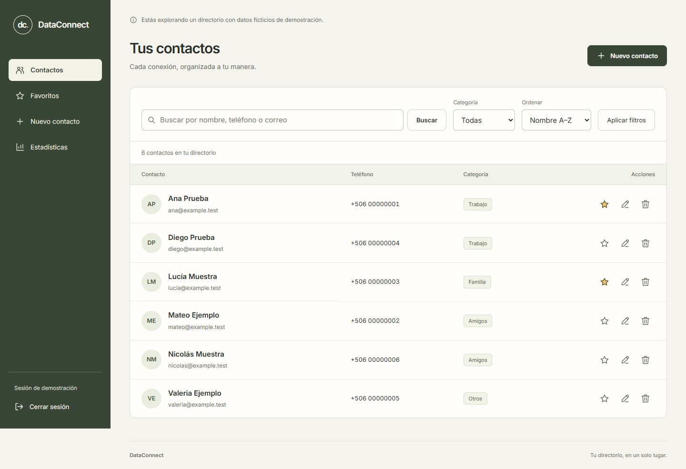
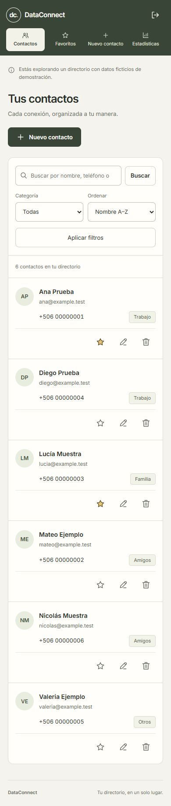

# DataConnect

**Un directorio de contactos claro, cercano y fácil de usar.**

Aplicación web desarrollada con **Python, Flask y Excel**. Permite organizar contactos, encontrarlos rápidamente y consultar estadísticas reales desde una interfaz adaptable a escritorio y móvil.

Proyecto de portafolio de [Cristofer Monge · Chriss-DW](https://github.com/Chriss-DW), evolucionado a partir de un proyecto académico de programación.



## Funcionalidades

- Crear, consultar, editar y eliminar contactos con confirmación.
- Buscar por nombre, teléfono, correo, dirección o categoría, sin distinguir tildes.
- Filtrar por categoría o favoritos y ordenar por nombre o incorporación reciente.
- Marcar favoritos y consultar una vista dedicada.
- Ver totales, distribución por categorías y últimos contactos agregados.
- Iniciar y cerrar una sesión real; validar formularios conservando los datos ingresados.
- Utilizar las operaciones principales sin JavaScript.

## Vista móvil



La identidad visual conserva el oliva y el crema del proyecto original. La navegación, tipografía, formularios, iconos y estados comparten un único sistema de estilos. Las fuentes y los iconos se sirven localmente.

## Ejecutar localmente

Requisitos: **Python 3.11 o posterior**, `pip` y Git. Las comprobaciones de esta versión se ejecutaron con Python 3.12.14.

```bash
git clone https://github.com/Chriss-DW/dataconnect.git
cd dataconnect
python -m venv .venv
```

Activar el entorno en PowerShell:

```powershell
.venv\Scripts\Activate.ps1
```

En macOS o Linux:

```bash
source .venv/bin/activate
```

Instalar e iniciar:

```bash
python -m pip install -r requirements.txt
python app.py
```

Abrir **http://127.0.0.1:5000**. No es necesario instalar Node.js para utilizar la aplicación.

### Demostración

El modo predeterminado contiene seis contactos ficticios y muestra un aviso visible.

| Campo | Valor de demostración |
|---|---|
| Usuario | `demo` |
| Contraseña | `dataconnect-demo` |

Estas credenciales son públicas e intencionales. El archivo Excel se genera automáticamente en `instance/contactos.xlsx`, fuera del control de versiones. Los cambios se conservan entre reinicios; la carga inicial no duplica contactos. Se utilizan correos `example.test` y teléfonos ficticios.

### Configuración privada

[.env.example](.env.example) documenta las variables disponibles. La aplicación lee variables del proceso; **no carga automáticamente archivos `.env`**. Por ejemplo, en PowerShell:

```powershell
$env:DATACONNECT_DEMO = '0'
$env:DATACONNECT_USERNAME = Read-Host 'Usuario'
$env:DATACONNECT_PASSWORD = Read-Host 'Contraseña privada (mínimo 12 caracteres)'
$env:DATACONNECT_SECRET_KEY = python -c "import secrets; print(secrets.token_hex(32))"
python app.py
```

`DATACONNECT_DATA_FILE` permite elegir una ubicación privada para el libro. En un despliegue HTTPS se debe establecer `DATACONNECT_HTTPS=1`, utilizar almacenamiento persistente y un servidor WSGI configurado con **un solo proceso**. El servidor incluido es de desarrollo. GitHub aloja el código; GitHub Pages no ejecuta este backend Flask.

## Organización

```text
dataconnect/
├── app.py                    # Punto de entrada
├── dataconnect/
│   ├── __init__.py            # Factoría, configuración, sesión y protección CSRF
│   ├── routes.py              # Rutas, búsqueda y validación
│   ├── storage.py             # Persistencia Excel e identificadores estables
│   ├── templates/             # Plantillas Jinja y componentes compartidos
│   └── static/                # CSS, JavaScript, iconos y fuente local
├── tests/                     # Integración y recorridos de navegador
├── docs/                      # Auditoría, evidencias y capturas
├── PRODUCT.md                 # Alcance del producto
├── DESIGN.md                  # Decisiones y reglas visuales
├── .env.example
└── requirements.txt
```

## Decisiones técnicas

- **Flask con factoría de aplicación:** separa configuración, rutas y almacenamiento y permite pruebas aisladas.
- **UUID por contacto:** editar o eliminar una fila no cambia la identidad de los demás registros.
- **Excel con escrituras atómicas:** el libro se reemplaza sólo después de guardar correctamente un archivo temporal. Un bloqueo coordina las solicitudes dentro de un proceso.
- **Datos como texto:** los valores ingresados no se convierten en fórmulas de Excel.
- **Sesiones y formularios protegidos:** hash de contraseña, CSRF en POST, cookies HttpOnly y SameSite, redirecciones locales y cabeceras de seguridad.
- **Mejora progresiva:** el diálogo de eliminación usa JavaScript; existe una confirmación HTML cuando está deshabilitado.

## Verificación

```bash
python -m unittest discover -s tests -v
```

Para los recorridos de interfaz se necesita Node.js y el navegador de Playwright:

```bash
npm install
npx playwright install chromium
npm run test:ui
```

También se puede usar un Microsoft Edge instalado estableciendo `PLAYWRIGHT_CHANNEL=msedge`. El script inicia su propio servidor, utiliza un Excel temporal y cierra ambos al terminar. Los resultados se guardan en `test-results/`.

Comprobación del 25 de octubre de 2026:

| Área | Resultado |
|---|---|
| Integración del servidor y persistencia | 42 pruebas aprobadas |
| Vistas de interfaz | 37 comprobaciones en cinco tamaños: 320, 390, 768, 1024 y 1440 px |
| Recorridos completos | Crear, editar, favorito, cancelar y confirmar eliminación en escritorio y móvil |
| Alternativa sin JavaScript | Acceso y confirmación HTML comprobados |
| Errores de ejecución y recursos externos | Ninguno en la ejecución final |

La [auditoría completa](docs/AUDIT.md) describe los defectos originales, las correcciones, la metodología y los límites de estas comprobaciones. No constituye una certificación de accesibilidad ni de seguridad.

## Alcance y próximos pasos

DataConnect está pensado como proyecto educativo y de portafolio, con un único usuario administrador y un directorio pequeño. La validación telefónica utiliza ocho dígitos de Costa Rica; no incluye una agenda internacional.

Excel no sustituye una base de datos: no se admiten varios procesos o instancias escribiendo el mismo libro, ni edición simultánea desde Excel. El listado todavía no tiene paginación, no existe control de versiones por contacto y la última edición válida prevalece. Para escalar: migrar a una base de datos, incorporar usuarios y permisos, paginación, recuperación de cuenta y límites de intentos de acceso. No se incluye importación automática del formato académico anterior ni de sus datos personales.

## Créditos

Desarrollo original y autoría del proyecto: **Cristofer Monge**. La revisión de esta versión reorganiza el código y corrige comportamiento, presentación y documentación. Inter se distribuye con la licencia [SIL Open Font License](dataconnect/static/fonts/OFL.txt). Los iconos SVG forman parte del código del proyecto.

El repositorio es público para consulta de portafolio. No se ha asignado una licencia adicional al código de la aplicación.
